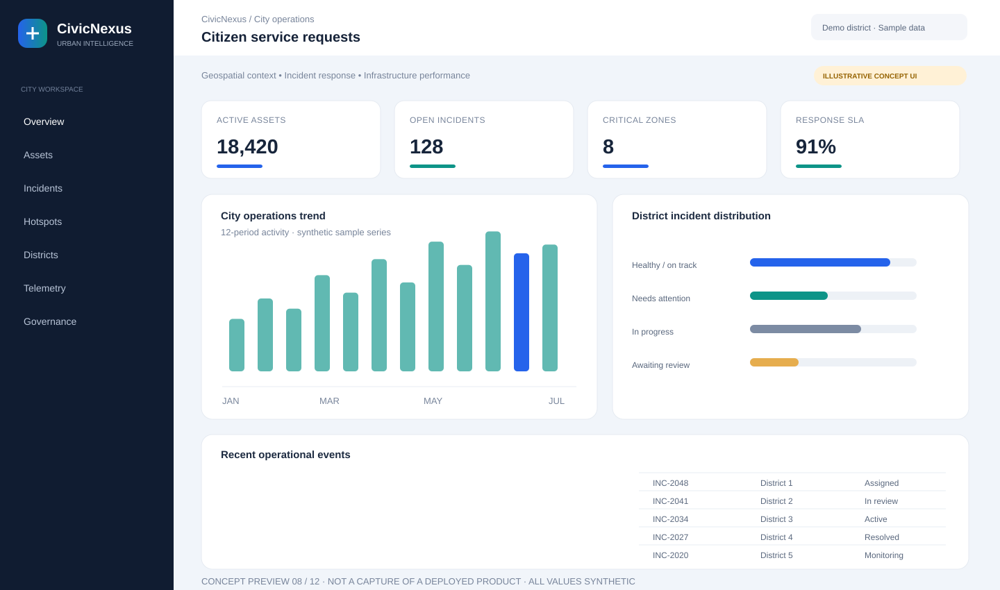
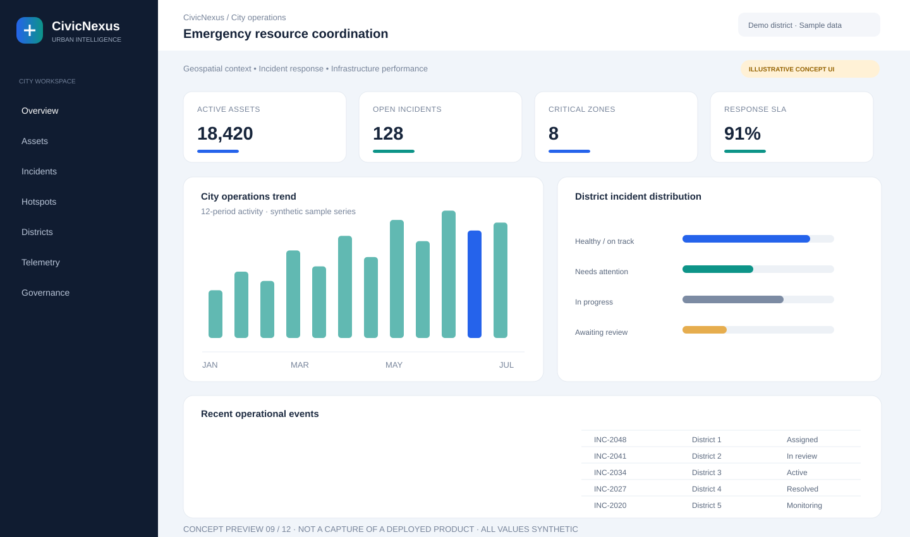

# CivicNexus

**Enterprise Smart City & Urban Intelligence Platform**

> Turn city infrastructure, incidents and spatial signals into accountable urban operations.

## Product overview

CivicNexus is a modular urban operations platform connecting city departments, infrastructure operators, field teams and approved partners through shared spatial and operational context.

## Current implementation

- Tenant- and jurisdiction-scoped geospatial incident management.
- GeoJSON/WGS84 location handling and geospatial query foundations.
- Incident assignment, severity, status history and auditable timeline.
- Hotspot intelligence with configurable radius, time window and risk scoring.
- Explainable incident priority and response recommendations.
- React/TypeScript web foundation and OIDC integration direction.

**Scope boundary:** live IoT feeds, city-system integrations, digital-twin simulation and predictive maintenance are product directions, not claims of live deployment.

## Technology stack

React 18 · TypeScript · Vite · Node.js · Express 5 · MongoDB · Mongoose · Keycloak OIDC · Zod · npm workspaces.

## Architecture

- `apps/web`: React operator console and client workflows.
- `apps/api`: versioned Express API, domain services and persistence.
- `packages/contracts`: shared API/domain contracts.
- `infra`: local infrastructure; `docs`: architecture and security decisions.
- Tenant and jurisdiction boundaries must be enforced server-side on every protected query.

## Local development

Prerequisites: Node.js 22+, npm 10+, Docker and MongoDB.

```bash
npm install
# Copy the app .env.example files and configure local MongoDB / OIDC settings.
npm run dev
```

Web commonly runs at `http://localhost:5173`; API commonly runs at `http://localhost:4000`.

Quality checks:

```bash
npm run typecheck
npm test
npm run build
npm run lint
```

## Security and data governance

Validate all external inputs; derive tenant and jurisdiction context from authenticated server-side identity; keep secrets out of source control; log consequential changes without sensitive payloads; and define retention controls for location and telemetry data. Use synthetic data in demos. Production city integrations require threat modelling, privacy review, operational failover and emergency-services stakeholder validation.

## Illustrative dashboard gallery

The 12 views below are **illustrative SVG dashboard concepts**, not screenshots captured from a running deployment. They contain synthetic data and do not prove that every depicted module is implemented. The gallery is intentionally arranged in one vertical column.

### 01. Urban operations center

Illustrative operator view for geospatial city operations, service coordination and infrastructure intelligence. All sample values are synthetic.


### 02. Geospatial asset registry

Illustrative operator view for geospatial city operations, service coordination and infrastructure intelligence. All sample values are synthetic.


### 03. Incident response desk

Illustrative operator view for geospatial city operations, service coordination and infrastructure intelligence. All sample values are synthetic.


### 04. Incident hotspot intelligence

Illustrative operator view for geospatial city operations, service coordination and infrastructure intelligence. All sample values are synthetic.


### 05. District performance

Illustrative operator view for geospatial city operations, service coordination and infrastructure intelligence. All sample values are synthetic.


### 06. IoT telemetry operations

Illustrative operator view for geospatial city operations, service coordination and infrastructure intelligence. All sample values are synthetic.


### 07. Predictive maintenance

Illustrative operator view for geospatial city operations, service coordination and infrastructure intelligence. All sample values are synthetic.


### 08. Citizen service requests

Illustrative operator view for geospatial city operations, service coordination and infrastructure intelligence. All sample values are synthetic.



### 09. Emergency resource coordination

Illustrative operator view for geospatial city operations, service coordination and infrastructure intelligence. All sample values are synthetic.



### 10. Environmental monitoring

Illustrative operator view for geospatial city operations, service coordination and infrastructure intelligence. All sample values are synthetic.


### 11. Mobility & traffic intelligence

Illustrative operator view for geospatial city operations, service coordination and infrastructure intelligence. All sample values are synthetic.


### 12. Governance & audit

Illustrative operator view for geospatial city operations, service coordination and infrastructure intelligence. All sample values are synthetic.


## Engineering delivery

CI, CodeQL, secret scanning and dependency auditing are maintained in GitHub Actions. The latest feature-branch dependency audit against the committed lockfile reports zero known vulnerabilities. Continue monitoring new advisories; remaining priorities include end-to-end tests, accessibility checks, tenant-boundary tests, immutable action pinning, observability and backup/restore exercises.

## Documentation

- [Architecture overview](docs/architecture/overview.md)
- [Tenant and jurisdiction isolation](docs/architecture/tenant-and-jurisdiction-data-isolation.md)
- [Incident hotspot intelligence](docs/architecture/incident-hotspot-intelligence.md)
- [Identity and access control](docs/architecture/identity-and-access-control.md)

## Responsible claims

CivicNexus is an actively developed portfolio project, not a certified public-safety or emergency-dispatch system. Spatial analytics and risk indicators are decision-support signals, not guarantees. Production deployment requires city-specific security, legal, accessibility and operational review.
