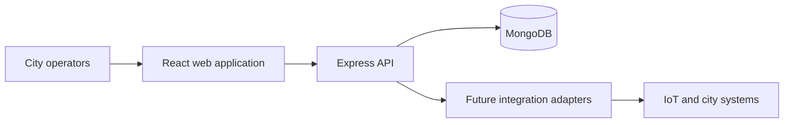

# Architecture overview

## Product boundary

CivicNexus is an operational intelligence platform connecting city departments, infrastructure operators, field teams, and approved external partners through shared spatial and operational context.

## System topology

## Workspace boundaries

- `apps/web`: presentation, navigation, accessibility, and client workflows.
- `apps/api`: HTTP boundary, domain orchestration, and persistence adapters.
- `packages/contracts`: TypeScript contracts shared across runtime boundaries.
- `infra`: local and deployment infrastructure.
- `docs`: architecture decisions, threat model, runbooks, and specifications.

## Initial runtime

The API validates configuration at startup, applies secure HTTP headers, restricts browser origins, limits JSON payload size, emits structured request logs, exposes a versioned health endpoint, and connects to MongoDB before listening.

## Domain evolution

Future bounded modules include geospatial assets, telemetry, work orders, incidents, citizen requests, resilience analytics, and data exchange. Cross-domain workflows should be orchestrated through application services rather than direct collection coupling.

## Engineering constraints

1. Validate external input at the boundary.
2. Keep secrets and environment-specific values out of source control.
3. Use least privilege for users, services, and integrations.
4. Preserve tenant and jurisdiction boundaries in every domain query.
5. Record consequential state changes in an auditable event trail.
6. Design for degraded integrations and partial city-system outages.
7. Govern geospatial and telemetry data products with retention policies.
